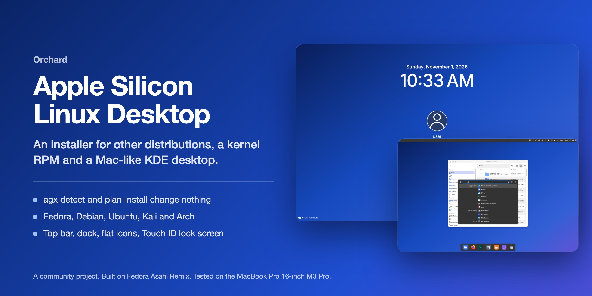
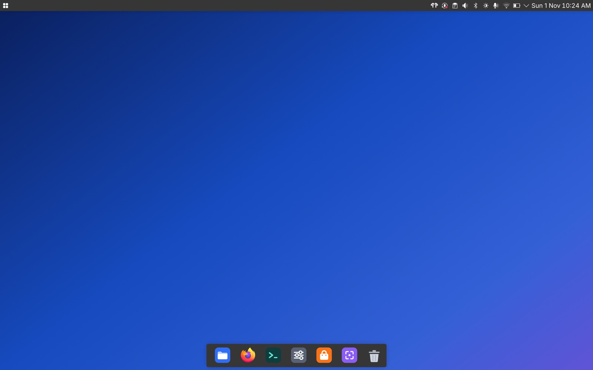
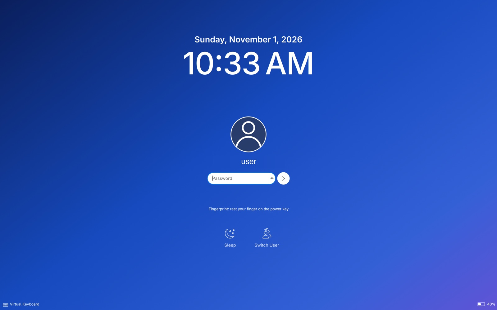
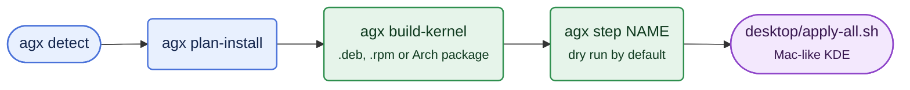

<p align="center">
  
</p>

<p align="center">
  <a href="https://github.com/zainnobody/orchard"><b>Orchard hub</b></a> ·
  <a href="#quick-start"><b>Quick start</b></a> ·
  <a href="desktop/README.md"><b>Desktop design</b></a> ·
  <a href="https://github.com/zainnobody/apple-silicon-linux-kit/blob/main/GUIDE.md"><b>Guide</b></a>
</p>

<div align="center">

[](LICENSE)  

</div>

Part of [Orchard](https://github.com/zainnobody/orchard), extra drivers and fixes for Linux on Apple silicon Macs. Start with the [Apple Silicon Linux Kit guide](https://github.com/zainnobody/apple-silicon-linux-kit/blob/main/GUIDE.md).


> **Community project.** It builds on Asahi Linux but is not part of it, and the Asahi developers do not support it. Please report problems here, not to Asahi.

Apple silicon drivers for any Linux distro. One tool, `agx`, installs the boot parts, the kernel, the drivers, the GPU stack and an optional Mac-like desktop on Ubuntu, Debian, Kali, Fedora or Arch.

Status (2026-10-27): phase 0 is done, and the offline part of phase 1. `agx build-kernel` plans the kernel package build (.deb, .rpm, Arch), and the kernel step installs that package. Phase 0 (2026-10-26): `agx detect` works. The install steps are ported from agx-linux-kit and run as dry runs on the Debian family, Fedora and Arch. Real installs (`--apply`) are not enabled yet. The Debian family has its own firmware hook now (2026-10-27): Ubuntu, Debian and Kali load the Apple firmware at boot like Fedora and Arch. It is tested with fake root file systems, not on a real boot yet.

## Screenshots

The optional Mac-like desktop (`desktop/`) on the tested M3 Pro: a top bar, a dock, flat icons and a flat lock screen with a Touch ID hint.

<table>
<tr>
<td></td>
<td></td>
</tr>
</table>

More screenshots and the full install path are in the [kit README](https://github.com/zainnobody/apple-silicon-linux-kit#get-the-full-setup).

## Quick start

```bash
git clone https://github.com/zainnobody/apple-silicon-linux-desktop.git distro-pack && cd distro-pack
```

```bash
./agx detect          # your Mac, its support level and the install plan. Changes nothing.
```

```bash
./agx plan-install    # every install step for this Mac, in order, with the reboots. Changes nothing.
```

The Mac-like desktop, as your normal user in a running Plasma session:

```bash
cd desktop && ./apply-all.sh light     # or dark. Each stage makes a backup and an undo script.
```

Touch ID on the lock screen with no key press (Plasma 6.8):

```bash
./80-lockscreen.sh touchid
```



## Try it

On a Mac that runs Linux:

```bash
./agx detect
```

It reads the device tree, os-release and the running state. It prints the Mac, its support level, the distro backend and what `agx install` will do. It changes nothing and needs no root. Use `./agx detect --json` for machine-readable output.

See every install step for this Mac, in order, with the reboots. Nothing changes:

```bash
./agx plan-install
```

Show one step: `./agx step <name>`. Steps: backup, platform, firmware, mesa, kernel, kernel-replace, bootbin-build, bootbin-use, boot-once, mesa-select, default, macos-switch. Run with sudo for an exact plan, because some boot folders are readable only by root.

Plan the build of the kernel package for this distro family. It checks the patch hashes and, with `--src`, that every patch applies on the pinned kernel commit. Nothing is built yet:

```bash
./agx build-kernel --src ~/agx-work/src/linux
```

`--family debian|fedora|arch` picks the package format on another host. `--check-config FILE` checks a kernel config for the required settings.

Exit codes: 0 ready, 2 unsupported Mac, 3 not Linux on Apple silicon, 4 unknown distro family, 5 no machine profile for this board.

Run the tests (any Linux or macOS, bash 3.2 or newer):

```bash
tests/run.sh
```

```bash
tests/install.sh
```

```bash
tests/initramfs.sh
```

```bash
tests/build.sh
```

Set `AGXFW_SH` to run the firmware scripts under another shell, for example `AGXFW_SH=bash`. The default is dash when it exists.

## Test results

| Suite | Checks | Result |
|---|---|---|
| `tests/run.sh` (detection) | 12 | All pass |
| `tests/install.sh` (install steps, dry runs) | 23 | All pass |
| `tests/build.sh` (kernel package build plan) | 30 | All pass |
| `tests/initramfs.sh` (Debian family firmware hook) | 51 | All pass |

Run on 2026-11-02 on macOS with bash 3.2. The Fedora kernel RPM build and its boot on the M3 are in `STATUS.md`.

## Layout

| Path | Contents |
|---|---|
| `agx` | The command |
| `lib/` | Shared helpers and detection |
| `lib/install.sh` | The install steps, ported from agx-linux-kit stages A to K |
| `lib/run.sh` | Dry-run command runner |
| `lib/grub.sh` | GRUB helpers for the Debian family and Arch |
| `lib/build.sh` | `agx build-kernel`: the kernel package build |
| `kernel/` | Kernel source pin, patch series with hashes, chip config, required settings |
| `tools/sync-kit-patches.sh` | Copies the patches and config from agx-linux-kit; `--check` compares |
| `backends/` | One file per distro family: Debian (Ubuntu, Kali), Fedora, Arch. Each one maps packages, initramfs, boot entries and file labels. |
| `machines/` | Machine profiles (J516S) |
| `system/` | Templates for the Mesa selector |
| `system/initramfs-tools/` | Apple firmware hook for the Debian family: a port of the asahi-scripts dracut and mkinitcpio hooks (MIT) |
| `data/socs.tsv` | Every M-series chip, its support level and its GPU path |
| `data/boards.tsv` | Board lines that override the chip level (tested and expected Macs) |
| `tests/run.sh` | Detection tests with fake root file systems |
| `tests/install.sh` | Install step tests: the commands of each backend, safety checks, and proof that a dry run changes no file |
| `tests/build.sh` | Kernel build tests: the plan per family, patch hashes, patch order on a fake kernel clone, config checks |
| `tests/initramfs.sh` | Firmware hook tests: fake initramfs roots, fake EFI partitions and stub commands |
| `PLAN.md` | Goal, limits, chip coverage, layers, install paths, desktop, phases |
| `STATUS.md` | Newest verified results on the reference Mac |
| `COMPARE.md` | macOS against Linux on the same Mac |

Reference Mac: MacBook Pro 16-inch M3 Pro (J516S), Fedora Asahi Remix 44, kernel `7.2.11-m3gpu+`.

The kernel patches and config come from the sibling repository `agx-linux-kit` (`tools/sync-kit-patches.sh`). The Mesa and m1n1 builds and the GPU tests are still there.

## Never in this repository

- Apple firmware. The Asahi installer copies it from each Mac's own macOS.
- Binaries of the M3 Mesa. Its license is not clear. The pack builds it on each Mac.
- Device tree dumps, serial numbers, ECIDs, network addresses or user names.

## License

The scripts and documents in this repository are under the GNU General Public License version 2 ([LICENSE](LICENSE)).

Some files keep the license of the project they come from. Their SPDX header names it:

- `desktop/lockscreen/`: changed copies of the KDE Plasma lock screen, GPL-2.0-or-later or LGPL-2.0-or-later, with the KDE authors' copyright lines.
- `system/initramfs-tools/`: a port of the asahi-scripts firmware hooks, MIT.
- `kernel/patches/`: Linux kernel patches, GPL-2.0.
